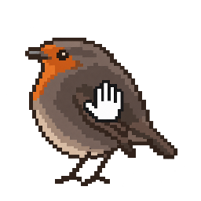

# Petbirds Lite



一只可以陪你摸摸桌面壁纸的像素知更鸟。点击小鸟展开动作菜单，选择戳一戳、亲亲、啥子、摸摸或祝福，在壁纸上留下手势、爱心和特效。

[下载 Windows Lite](https://github.com/banirabbit/petbirds/releases/download/desktop-webview2-v2.2.0-preview.1/PetbirdsLite-v2.2.0-win-x64.zip) · [查看发布说明](https://github.com/banirabbit/petbirds/releases/tag/desktop-webview2-v2.2.0-preview.1) · [打开网页版](https://banirabbit.github.io/petbirds/)

当前桌面版本：**Lite v2.2.0 Preview 1**。使用 C# / WPF 和系统 WebView2，运行包约 490 KB，不包含浏览器内核。

## 视频演示

### 演示一

https://github.com/user-attachments/assets/164640a1-b268-4d2f-be51-0e1654083840

### 演示二

https://github.com/user-attachments/assets/32eab5b9-981b-4297-801e-f776fba6707a

### 演示三

https://github.com/user-attachments/assets/071a91c9-9a92-4690-823e-e35fb76e61aa

## 使用 Lite

1. 下载并完整解压运行包，运行 `PetbirdsLite.exe`。更新时先从系统托盘退出正在运行的版本。
2. 平时只显示一个透明置顶的知更鸟，按住拖动可以移动位置。
3. 左键点击知更鸟展开或收起五个圆形动作按钮，选择动作后菜单自动收起。
4. 回到桌面，选择动作后点击壁纸互动；壁纸本身不会摇晃或缩放。
5. 鼠标右键或按 `Esc` 结束互动，立即撤掉互动覆盖层。
6. 右键知更鸟选择“隐藏”或“退出程序”。隐藏会同时结束互动，点击系统托盘的小鸟图标可以重新显示。

知更鸟会悬浮在其他普通应用窗口上方。空闲时只占小图标区域；选择动作后，互动层会覆盖小鸟所在屏幕的工作区以接收点击，结束互动后恢复正常操作。

### 五个动作

| 动作 | 效果 |
| --- | --- |
| 戳一戳 | 点击出现戳戳手势和小爱心 |
| 亲亲 | 点击冒出爱心 |
| 啥子 | 在屏幕中央显示巨大的白色“啥” |
| 摸摸 | 白色手掌与闪光，按住移动可以连续摸摸 |
| 祝福 | 在屏幕中央显示巨大的㊗️ |

### 运行要求

- Windows 10 / 11 x64。
- [.NET Framework 4.8](https://dotnet.microsoft.com/download/dotnet-framework/net48)。
- [Microsoft Edge WebView2 Evergreen Runtime](https://developer.microsoft.com/microsoft-edge/webview2/)。

知更鸟和动作菜单由原生 WPF 绘制，WebView2 只承载互动特效。客户端不需要 Node.js，也不需要后台 PowerShell 进程。程序不设置开机启动，不读取或修改壁纸文件，不上传图片。WebView2 缓存位于 `%LOCALAPPDATA%\PetbirdsLite\WebView2`。

## 网页版

[直接打开网页版](https://banirabbit.github.io/petbirds/)，或下载仓库后用浏览器打开 `index.html`，无需启动服务。

网页初始显示“待上传”，选择小动物照片后即可互动。电脑端使用右侧圆形按钮，手机端点击右下角悬浮按钮展开工具；手机图片会等比例完整显示。图片只在当前浏览器中读取，刷新后需要重新选择。

## 从源码构建 Lite

需要 Windows 和 .NET SDK（已验证 9.0.305）。

```powershell
./desktop-webview2/Build.ps1 -Test
./desktop-webview2/Package.ps1
```

运行包生成于 `desktop-webview2/release/PetbirdsLite-win-x64/`。

| 目录或文件 | 内容 |
| --- | --- |
| `desktop-webview2/` | Lite 原生知更鸟、动作菜单、WebView2 宿主和构建脚本 |
| `desktop-webview2/ui/` | Lite 互动覆盖层页面 |
| `desktop-webview2/tests/` | 状态、桥接与运行包自检 |
| `shared/effects.js` | 网页版与 Lite 共用的图标和互动特效 |
| `assets/` | 像素知更鸟图标与原始素材 |
| `index.html`、`style.css`、`app.js` | 网页版页面、样式与交互 |

`Build-Icons.ps1` 从 `assets/robin-source.png` 生成 PNG 和多尺寸 ICO。`Prepare-Web.ps1` 从 Lite 的 `ui/` 与 `shared/` 组装运行资源。
